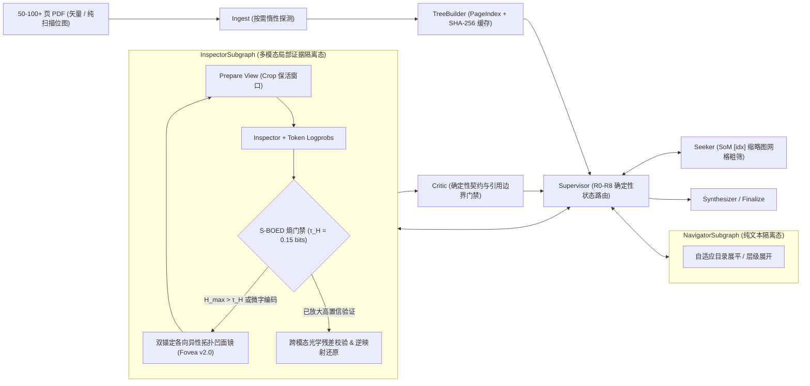

# FoveaDoc (ZoomDoc-Agent) v0.2.0

**面向 50–100+ 页长文档细粒度视觉推理的主从子图多智能体运行时与各向异性拓扑凹面镜系统**

FoveaDoc 针对长文档多模态检索与推理中的三项物理矛盾构建端到端解决方案：
1. **全局分辨率退化与 Token 预算矛盾**：整页低分辨率缩略图（72–96 DPI）下，4–5pt 财务附注与密集矩阵编码低于奈奎斯特采样边界，触发光学形近幻觉（如 `0/D/Q`、`6/8/B`、`2/Z`）；若全书以 200+ DPI 切片输入 VLM，单次查询开销超过 $1.6 \times 10^4$ Prompt Tokens 且端到端 P95 延迟超过 $300\text{ s}$。
2. **言语置信度失准（Verbal Overconfidence）**：视觉语言模型在低清视图错读微字时仍输出 `confidence >= 0.90` 的言语自评，导致启发式自愿放大（Voluntary Zoom）触发率仅为 `25.0%–31.2%`。
3. **局部矩形裁剪的拓扑语义断裂**：传统局部矩形裁剪（Linear Rectangular Crop）在放大单元格的同时物理截断页顶/页中列表头与左侧行名，当首步定位框发生单行偏移或面临多列同构数值时丧失行列归属参照。

---

## 一、 系统架构拓扑（Agent Runtime & Full-Stack Observatory）

系统基于 **LangGraph 主从状态机 + 双物理隔离子图 + FastAPI SSE 实时流式服务 + React 19 交互观测台** 构建：



### 核心 Agent 工程不变量
- **物理级双向上下文隔离**：所有 Base64 图像字节仅存在于 `OpenAICompatVLM.generate` 局部栈帧；所有局部裁剪图路径仅驻留于 `InspectorSubState`，退出子图时折叠为纯文本 `EvidenceReport` 与全页归一化 `CitedRegion`。每次运行自动审计 `supervisor_state.json`，强制断言 `data:image`、`base64,`、`/sub/` 出现次数恒为 `0`。
- **按需惰性渲染与内容寻址缓存**：100 页文档在 `ingest` 阶段零图像渲染，仅对 `Navigator` 选定的叶子章节按需渲染并按 `SHA-256(PDF) + DPI` 持久化缓存（实测跨查询缓存命中率 `75.0%`，渲染耗时占比压缩至 `1.6%–2.3%`）。
- **全链路结构化可观测性**：`TraceLogger` 同时向磁盘 `trace.jsonl` 与内存 SSE 队列推送包含 `trace_id`、`span_id`、`namespace`、`prompt_tokens`、`latency_ms` 的原子事件。

---

## 二、 核心算法机制（FoveaDoc v2.0）

### 1. 多锚定带各向异性拓扑凹面镜（Multi-Band Anisotropic Topological Foveation）
设源页面高分辨率尺寸为 $(W, H)$，目标焦点框为 $[x_1, x_2] \times [y_1, y_2]$，输出画布尺寸为 $(W', H')$。不同于各向同性鱼眼变形（扭曲直线表格网格）或局部矩形裁剪（截断表头与行名），系统构造可分离一维分段严格单调双射 $T: [0, W] \times [0, H] \to [0, W'] \times [0, H']$：

$$T(x, y) = \bigl(g_x^{-1}(x),\; g_y^{-1}(y)\bigr), \qquad \det J_T(x, y) = \frac{\partial g_x^{-1}}{\partial x}\cdot\frac{\partial g_y^{-1}}{\partial y} > 0$$

- **页中表头与行名分隔线自动检测（`detect_table_anchor_bands`）**：基于墨水密度投影自动锁定左侧行名列竖向分隔线 $x_{\text{stub}} \in [0, 0.33W]$ 与焦点上方的页中表格列头横线带 $[ty_1, ty_2]$，使页中起始表格的列头与焦点列保持 $100\%$ 垂直像素共线，左侧行名与焦点行保持 $100\%$ 水平像素共线。
- **宽跨度非反向压缩不变量（Focus Non-Compression Invariant）**：强制有效焦点占比 $s_{\text{focus}}^{\text{eff}} = \max\!\bigl(s_{\text{focus}},\, \min(0.95,\, \Delta x_{\text{focus}} / W)\bigr)$，并配合自适应长宽比画布 `compute_adaptive_fovea_size`，消除整行宽框输入下的边缘反向放大退化。
- **解析分段精确逆映射（`fovea_box_to_page_box`）**：利用单调节点序列 $(u_k, x_k)$ 与 $(v_k, y_k)$ 将凹面镜画布上的局部引用框精确反演回原页归一化坐标，实测往返最大绝对误差 $\le 2.5 \times 10^{-4}$。

### 2. S-BOED Token 香农熵主动感知门禁（Active Perception Gate）
仅在 `Inspector` 节点启用 `logprobs=True, top_logprobs=5`，提取答案子串对应 Token 序列的归一化 Top-5 香农熵：

$$H(Y_t) = -\sum_{v \in \mathcal{V}_5} \tilde{p}_t(v)\log_2 \tilde{p}_t(v), \qquad H_{\max}(Y_{\text{ans}}) = \max_{t \in \mathcal{I}_{\text{ans}}} H(Y_t)$$

当 `zoom_count == 0` 且满足 $H_{\max}(Y_{\text{ans}}) > \tau_H$（默认 $\tau_H = 0.15\text{ bits}$）或命中细粒度编码正则时，状态机拦截首轮盲猜并转入强制放大回路：
- 若页面含矢量文本层，通过多阶几何定位器提取紧致框（不含未验证盲猜文本，消除 Step 2 确认偏置）；
- 若页面为纯位图扫描页（零矢量文本），自动切换为两阶段视觉定位（Hybrid Symbolic–Visual S-BOED）或笔画梯度能量密集区检测（`locate_raster_dense_roi`）。

### 3. 行列十字准星定位与光学混淆矩阵残差校验（`zoomdoc/vision/residual.py`）
- **Tier-0 矩阵十字准星定位**：在多行多列密集编码页（`page_code_count >= 4`）中，联合问题中的行指标名 $y_{\text{row}}$ 与列头名 $x_{\text{col}}$ 执行几何交集框选。
- **单字符替换与插入/缺失（Indel）残差纠偏**：基于光学混淆代价矩阵（如 $C(\text{0}, \text{D}) = 0.25$，$C(\text{2}, \text{Z}) = 0.30$，$C_{\text{indel}} = 0.65$）在局部引用框内检索矢量真值；仅当唯一最优候选满足 $0 < d_{\text{opt}} \le 1.5$ 且次优间距裕度 $> 0.05$ 时执行修正，等距歧义候选严格弃权。

---

## 三、 受控变量实测评测结果

所有实验均在 `qwen3.8-flash`（DashScope API）、`temperature = 0`、`seed = 42`、相同归一化判分函数下物理执行；Prompt 与评测集金标之间的精确匹配数与字符 4-gram 重叠率经 `audit_prompt_contamination` 核验均为 `0.0%`。

### 1. 主基准与正交消融实验（`eval/m4/manifest_full16.jsonl`, $N=16$, 50–100 页长文档）

| 实验组 | 端到端准确率 | 95% Wilson CI | Nav Recall | Seek Recall | Zoom 触发率 | 残差纠偏 | Avg Prompt Tokens | P50 / P95 耗时 (s) | Errors |
|---|---|---|---|---|---|---|---|---|---|
| `B0` (1024px 滑窗无放大) | 31.2% (5/16) | [14.2%, 55.6%] | 100.0% | 75.0% | 0.0% | 0 | 16,532 | 170.2 / 302.9 | 0 |
| `B1` (448px 滑窗缩略图) | 43.8% (7/16) | [23.1%, 66.8%] | 100.0% | 81.2% | 12.5% | 0 | 17,385 | 169.4 / 231.9 | 0 |
| `B2` (PageIndex 树无放大) | 37.5% (6/16) | [18.5%, 61.4%] | 100.0% | 100.0% | 0.0% | 0 | 5,903 | 44.4 / 115.4 | 0 |
| `M3` (树导航 + 自愿矩形裁剪) | 43.8% (7/16) | [23.1%, 66.8%] | 100.0% | 100.0% | 31.2% | 0 | 6,631 | 50.7 / 127.2 | 0 |
| `M5_no_sboed` (移除 S-BOED 门禁) | 93.8% (15/16) | [71.7%, 98.9%] | 100.0% | 100.0% | 50.0% | 2 | 7,186 | 49.5 / 88.2 | 0 |
| `M5_crop` (S-BOED + 线性裁剪) | 100.0% (16/16) | [80.6%, 100.0%] | 100.0% | 100.0% | 100.0% | 0 | 8,222 | 59.9 / 100.6 | 0 |
| **`M5` (Full FoveaDoc)** | **100.0% (16/16)** | **[80.6%, 100.0%]** | **100.0%** | **100.0%** | **100.0%** | **0** | **9,056** | **70.6 / 103.6** | **0** |

- **配对统计显著性**：
  - `M5` vs `B0`：11 胜 0 负，准确率增益 `+68.8%`，双侧精确 McNemar 检验 **$p = 0.0010$**；Paired Bootstrap（$B=2000$）Prompt Token 消耗比 $\hat{R} = 0.5478$，节省率 **`45.22%`**（95% CI `[38.05%, 51.50%]`）。
  - `M5` vs `M3`：9 胜 0 负，准确率增益 `+56.2%`，双侧精确 McNemar 检验 **$p = 0.0039$**。

### 2. M6 宽多列密集矩阵与零矢量纯扫描位图页压力测试（`eval/m6_matrix/manifest_m6.jsonl`, $N=12$）

针对 50 页长文档内嵌 `18 行 × 5 列`（`90` 个 3.8pt 混淆编码单元格，表头位于 `y = 195pt`）的高密度矩阵，包含 `6` 例矢量页与 `6` 例零文本层纯位图扫描页（`page.get_text("words") == []`，220 DPI 光栅化）：

| 实验组 | 总体准确率 ($N=12$) | 95% Wilson CI | 矢量矩阵子集 ($N=6$) | 纯位图扫描子集 ($N=6$) | Zoom 触发率 | Avg Prompt Tokens | P50 / P95 耗时 (s) | McNemar $p$ (vs NoZoom) |
|---|---|---|---|---|---|---|---|---|
| `NoZoom` (1024px View) | 0.0% (0/12) | [0.0%, 24.2%] | 0.0% (0/6) | 0.0% (0/6) | 0.0% | 4,841 | 26.3 / 60.4 | --- |
| `LinearCrop` (S-BOED + 矩形裁剪) | 91.7% (11/12) | [64.6%, 98.5%] | 100.0% (6/6) | 83.3% (5/6) | 100.0% | 7,149 | 48.9 / 116.9 | 0.0010 |
| **`FoveaDoc_v2` (双锚定凹面镜 v2.0)** | **83.3% (10/12)** | **[55.2%, 95.3%]** | **83.3% (5/6)** | **83.3% (5/6)** | **100.0%** | **8,087** | **62.5 / 115.1** | **0.0020** |

- **典型机制对照与失败样例建档（Bad Case Cataloging）**：
  - **行偏移自纠偏优势（`m6_case_007`，纯位图扫描页）**：Step 1 视觉定位框在 18 行密集矩阵中向下偏移 1 行。`LinearCrop` 因截断左侧行名无从察觉错行，直接输出相邻行编码 `ZD-5208-ZQ`（错误）；`FoveaDoc_v2` 保留左侧行名锚定带与页中表头带，在放大图中对齐 `Intraday Settlement × FY2024` 并准确输出 `ZD-6812-VV`。
  - **已建档失效模式**：`FoveaDoc_v2` 在 `m6_case_001`（`ZD-9164-KZ` vs `ZD-9195-KZ`，双字符误差 `d=2.0 > 1.5` 超出安全残差纠偏半径）与 `m6_case_012`（220 DPI 光栅化扫描页上 3.8pt 尾字母 `QG` 像素量化粘连误读为 `GG`）发生失误，完整原始轨迹保留于 `eval/m6_matrix/runs/`。

---

## 四、 快速启动（Turnkey Quickstart）

### 1. 环境安装与配置
```powershell
python -m venv .venv
.\.venv\Scripts\pip install -e ".[dev]"
Copy-Item .env.example .env
# 在 .env 中填入 VLM_API_KEY（未配置密钥时，Web 工作台仍可零成本回放全部真实评测轨迹并交互体验凹面镜算法实验室）
```

### 2. 启动全栈可视化观测台（FastAPI + React 19 Workbench）
```powershell
.\.venv\Scripts\python.exe scripts/serve.py --host 127.0.0.1 --port 8000
```
浏览器访问 `http://127.0.0.1:8000`，包含四大交互模块：
1. **Agent Studio（多智能体执行工作台）**：支持 `28` 个长文档/矩阵预设用例一键**动态回放真实轨迹**、上传任意自定义 PDF 发起 **SSE 实时流式推理**、实时观测 LangGraph 主从子图拓扑、PageIndex 章节树、S-BOED 香农熵阈值条与多分辨率证据切片。
2. **Fovea Lens Lab（各向异性拓扑凹面镜实验室）**：在任意 PDF 页面上拖拽鼠标实时框选 ROI，`<500 ms` 并排对比「传统局部矩形裁剪」与「FoveaDoc v2.0 双锚定凹面镜」，可视化页中表头带/左侧行名检测线及一维分段单调映射曲线 $g_x(u), g_y(v)$。
3. **Benchmark Observatory（评测与消融观测台）**：交互式渲染成本–准确率帕累托前沿、M6 矢量/纯扫描分组柱状图、统计显著性指标与 300 DPI 论文配图。
4. **Trace & Isolation Audit（全链路轨迹与物理隔离审计）**：多命名空间 Span 瀑布流、`supervisor_state.json` 零图像泄漏契约核验与原始 JSON 载荷检视。

### 3. 命令行推理与全量确定性回归测试
```powershell
# 单次长文档 CLI 推理
.\.venv\Scripts\python.exe scripts/run_m5.py --pdf eval/m4/pdfs/doc1_financial_100p.pdf --question "What is the exact Security ID in the confirmed table under Section 3.1 Consolidated Balance Sheet Disclosures?"

# 静态字节码编译检查与全量离线测试套件（无需外部网络/API Key）
.\.venv\Scripts\python.exe -m compileall -q zoomdoc scripts tests
.\.venv\Scripts\python.exe -m pytest -q

# （可选）修改前端源码后重新编译静态产物至 zoomdoc/server/static/
Set-Location frontend; npm install; npm run build
```

---

## 五、 适用边界与有效性威胁剖析（Threats to Validity）

1. **内部有效性（Internal Validity）**：云端推理服务（`qwen3.8-flash`）即使锁定 `temperature = 0, seed = 42`，在动态批处理与混合精度规约下仍存在单题级边界抖动；本仓库通过双侧精确 McNemar 检验、2000 次配对 Bootstrap 置信区间及全离线 `FakeVLM` 契约测试（75 项）解耦算法逻辑与远端推理噪声。
2. **外部有效性（External Validity）**：
   - 当输入为既无目录书签（`toc == []`）又无矢量文本层的纯扫描长文档时，`PageIndex` 自动降级为均匀 20 页叶子分块树，章节语义剪枝增益下降；
   - 一维可分离正交网格变形假设文档排版主轴与页面坐标轴近似平行（倾斜角 $|\theta| \le 3^\circ$）；面对重度透视畸变或大角度倾斜扫描件，需前置文档几何矫正（Deskewing）模块。
3. **结构有效性（Construct Validity）**：由于 `Inspector` 在放大轮同时保留 `1024px` 全页概览图（`Image 0`），当页面表头字号较大（$\ge 8\text{ pt}$）且首步定位框未发生跨行偏移时，线性裁剪可借助 `Image 0` 推断列归属（如 `M5_crop` 在单表页达 `100.0%`）；双锚定凹面镜的核心结构增益体现在首步定位框发生单行偏移时的同图行列共线自校验能力与纯视觉单图自包含证据归档。

---

## 六、 代码仓库目录拓扑

- [zoomdoc/vision/fovea.py](zoomdoc/vision/fovea.py)：多锚定带一维分段单调映射、页中表头/行名自动检测、自适应画布长宽比与精确逆映射。
- [zoomdoc/vision/residual.py](zoomdoc/vision/residual.py)：矩阵行列十字准星定位、纯扫描页梯度能量 ROI 检测、光学混淆矩阵 Levenshtein/Indel 残差校验。
- [zoomdoc/graph/supervisor.py](zoomdoc/graph/supervisor.py)：LangGraph 主图 `R0–R8` 状态路由、按需惰性渲染与 `on_event` 实时流式事件总线。
- [zoomdoc/graph/inspector_subgraph.py](zoomdoc/graph/inspector_subgraph.py)：S-BOED 香农熵门禁、矢量/纯扫描混合聚焦回路与局部证据物理隔离。
- [zoomdoc/server/app.py](zoomdoc/server/app.py)：FastAPI + SSE 流式推理、轨迹回放、PDF 上传、凹面镜实时对比预览与评测统计 API。
- [frontend/src/](frontend/src/)：React 19 + TypeScript + Vite 可视化观测台前端工程。
- [eval/m4/](eval/m4/) & [eval/m6_matrix/](eval/m6_matrix/)：受控基准清单、物理运行轨迹、统计报告、300 DPI 配图与 LaTeX 三线表。
- [PROJECT_GUIDE_AND_INTERVIEW.md](PROJECT_GUIDE_AND_INTERVIEW.md)：19 章系统架构精讲、双岗位简历模板、18 项前置原理、26 道高频面试题与大厂一面/二面追问推演。
- [TECH_DEEP_DIVE_9Q_5Q_ROADMAP.md](TECH_DEEP_DIVE_9Q_5Q_ROADMAP.md)：六大关键技术点“技术九问”、项目“业务五问”与绑定简历 Bullet 的最短源码学习路线。
